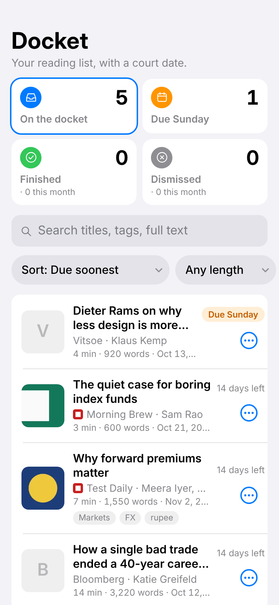
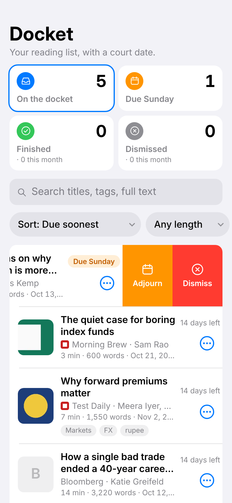
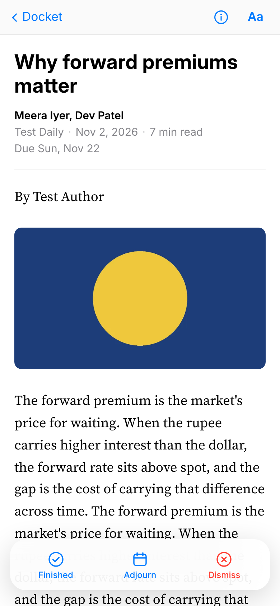

# Docket

Your reading list, with a court date. Save it, read it offline, and decide by Sunday. By AR.

A read-it-later Chrome extension. Free, no account, nothing leaves your computer.

  

**Why another one?** Most read-it-later apps let your list grow forever. Docket gives every article a court date: read it, adjourn it a week, or dismiss it by Sunday.

## Install (2 minutes)
1. Click **Code → Download ZIP** on this page and unzip it (or `git clone` it).
2. Open `chrome://extensions` and switch on **Developer mode** (top right).
3. Click **Load unpacked** and choose the unzipped folder (the one containing `manifest.json`).
4. Pin the Docket icon to the toolbar.

## Use
- **Save:** click the icon then "Save this page", or press **Alt+Shift+S** on any article.
- **Read:** open the list (icon → "Open list"). Articles open in a clean reader that works with no internet. Text, images and your scroll position are stored on your computer.
- **Verdict:** every article ends one of three ways: *Finished*, *Adjourn a week*, or *Dismiss*.
- **"I have 10 minutes":** the "Any length" menu on the list filters by reading time.

## What Docket remembers about each article
Source and site icon, author(s), published and updated dates, section, tags, summary, language, reading time, word count, images saved, a cover thumbnail, and when it was saved and when it is due. Tap the (i) in the reader to see all of it.

## Search, sort and filter
- **Full-text search** works offline across titles, authors, tags, summaries and the whole article text. Matches inside the text show a snippet.
- **Sort** by due date, shortest or longest read, recently saved, newest or oldest published.
- **Filter** by reading time ("Up to 10 min") and by source.

## The Sunday Hearing
An article stays on the docket at least 7 days (setting: 7/10/14), then comes up for hearing at the end of the next Sunday. Anything you have not dealt with is dismissed: its text is deleted and only the title and original link remain in the Dismissed tab. "Adjourn a week" pushes the hearing to the following Sunday.

## Weekend nudge
- Saturday at your chosen time: "N articles on your docket · X due Sunday night · Y dismissed this month".
- Sunday 18:00: only if something is due tonight.
- Weekdays: silence. The toolbar badge shows the Sunday count on weekends only.
- Chrome must be open. If it was closed, the check runs the next time you open it.

## Backup
List page → Settings → **Download backup**. Restore adds anything missing. Nothing leaves your computer.

## Permissions, plainly
- `<all_urls>` host access: to read the page you choose to save and to download its images so they work offline. Nothing is sent anywhere.
- `storage` + `unlimitedStorage`: keeps saved articles locally.
- `alarms` + `notifications`: the Sunday Hearing and weekend nudge.
- `offscreen`: a hidden page that cleans the article HTML and embeds images.
- `scripting` + `tabs`: to run the reader extraction on the tab you save.

## Fonts
Apple's own fonts (SF Pro, New York) are licensed for Apple devices only, so Docket cannot ship them. It bundles the closest open-source equivalents instead: **Inter** (the UI, with optical sizes like SF Text and Display) and **Source Serif 4** (the reader text, like New York). On a Mac, iPhone or iPad the interface switches to the real SF Pro automatically. Both bundled fonts are under the SIL Open Font License (licences in `fonts/`).

## On a phone

The layout is phone-first (swipe right = Finished, swipe left = Adjourn or Dismiss, action sheets, bottom Aa sheet). Chrome for phones cannot run extensions, so a phone version needs the PWA (planned).

## Known limits (v1)
- Desktop Chrome only. Phone version is Phase 3.
- Saves what your browser shows, so paywalled articles you can read will save, and ones you can't won't.
- Up to 15 images per article, each shrunk to 1000px wide.
- Videos, embeds and interactive charts are not saved.
- Pages that are not articles (dashboards, apps) may be rejected with "No article found".

## Licence
MIT. Bundled fonts keep their own licences (SIL OFL) in `fonts/`. Readability.js is Apache-2.0 (Mozilla).
